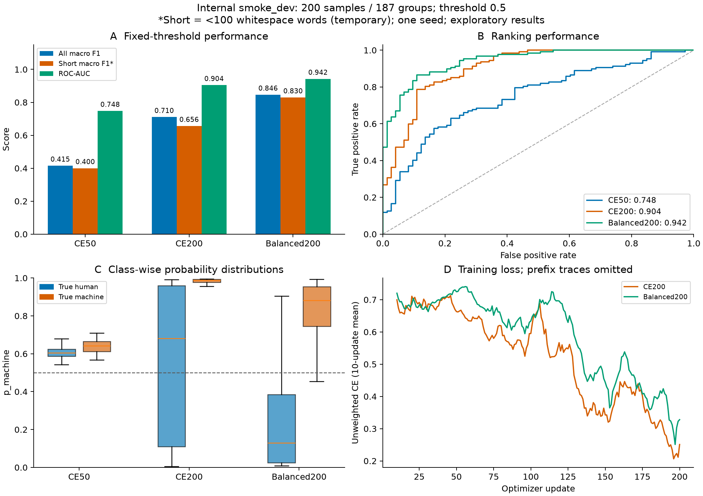
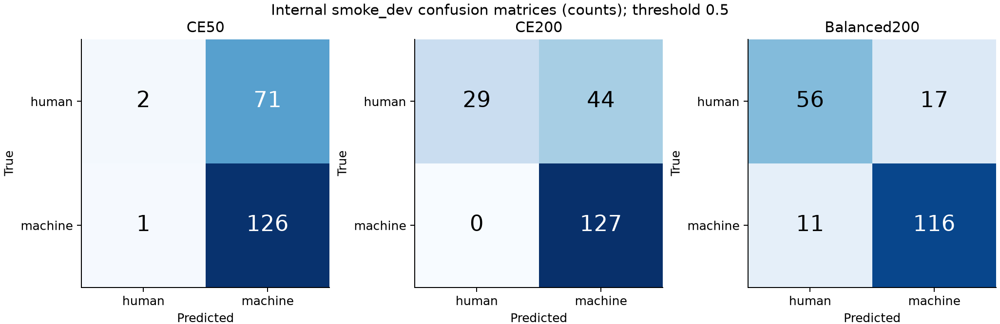

# B05与首轮改进实验：训练不足、类别偏置与恢复能力

当前较好的候选为 **Balanced200：全体宏F1=0.8462、短文本宏F1=0.8295、临时加权分=0.8412、ROC-AUC=0.9424**。这只是 `internal-v1` 的1000条训练/200条smoke_dev开发结果，不能当作完整dev、内部test或官方比赛成绩。没有读取内部test或官方验证集，没有搜索预测阈值。

产物在 `work/b-model`，通过[草稿PR #2](https://github.com/Cyrus-0704/nlp1-ai-text-detection/pull/2)交接，尚未合并main；只共享必要预测、参数、汇总、图及图表源数据，模型/优化器/环境/完整个人日志留本地。

## 对照设计与结果

三者均使用固定原始 `FacebookAI/xlm-roberta-base` revision `e73636d4f797dec63c3081bb6ed5c7b0bb3f2089`；seed42、max_length256、batch1、梯度累积16、lr2e-5恒定、AdamW weight_decay0.01、FP16、梯度检查点、num_workers0。仅内部训练集更新梯度；A的评估脚本显式使用阈值0.5、`--short-by word --short-threshold 100`。

| 实验 | 全体宏F1 | 短文本宏F1 | 临时加权分 | AUC | human召回 | machine召回 |
| --- | ---: | ---: | ---: | ---: | ---: | ---: |
| CE50，同轨迹50步 | 0.4152 | 0.4000 | 0.4106 | 0.7477 | 0.0274 | 0.9921 |
| CE200，无加权200步 | 0.7105 | 0.6563 | 0.6942 | 0.9043 | 0.3973 | 1.0000 |
| Balanced200，加权200步 | **0.8462** | **0.8295** | **0.8412** | **0.9424** | **0.7671** | 0.9134 |

短文本仅30条，按空白词数<100判断，属于临时口径。临时加权分为0.7×全体宏F1+0.3×短文本宏F1；不填官方分数。

CE50直接加载CE200同一训练轨迹的50步检查点，因此50→200对照没有重新挑初始化或训练顺序。新增可恢复采样器使用独立的seeded逐epoch排列，区别于早期DataLoader的隐式随机顺序；此前50步结果0.3884保留在原交接目录，不能与本轮CE50混称同一次运行。

CE200/Balanced200的逐次抽取顺序已核对；两者实际更新都是200次。FP16分别跳过3/2次更新，实际处理3248/3232条（允许跨epoch重复）；这一轻微数据暴露差异也记录在摘要中。两项实验的训练代码commit分别为 `01b367b` / `d6e726d`，训练引擎及损失实现相同，加权方式不同。





CE50与CE200共享前50步，训练曲线不重复绘制CE50。曲线绘制未加权CE的10次更新滑动均值，避免直接比较不同加权目标的损失数值。图表已检查文字、图例、遮挡及标签对应关系，PNG/PDF均提供。

## 可以得出的判断

1. **50步训练不足。** 同轨迹延长至200步，宏F1增加0.2953。按187个dev组配对bootstrap（1000次，seed42），差值95%区间为[0.2149,0.3682]。
2. **类别偏置是当前可改善的问题。** 无加权200步漏掉44/73条human；加权后降到17/73，同时machine错误为11/127。加权相对无加权宏F1增加0.1357，配对区间[0.0618,0.2106]。Brier分数从0.1744降至0.0936，log loss从0.6209降至0.3018；本轮既改善固定阈值决策，也改善了概率误差。
3. **输入截断值得后续单独比较。** 训练/调参小样超过256 token的比例为75.7%/73.0%，超过512 token为23.1%/27.0%。这支持安排512 token或分块聚合实验，但目前没有证明它会提高指标。

bootstrap只反映这批dev组在当前固定模型下的抽样不确定性，不覆盖训练seed变化、训练集变化或未知生成器。Balanced200宏F1区间为[0.7929,0.8951]。域/生成器切片多为小样本；`slices.csv` 标注小样本/单类别，单类别不报告双类宏F1，只报告对应类召回。它们不能证明生成器归因能力或可靠的未见生成器泛化。

## 类别加权与断点验证

权重仅用训练标签计算：human=1.3661202、machine=0.7886435。实现 `mean(每条CE * w[label])`，训练集期望权重为1；batch1下不能用会按当前batch权重重新归一化的默认加权均值，否则权重抵消。相关定义见[PyTorch交叉熵文档](https://docs.pytorch.org/docs/2.14/generated/torch.nn.CrossEntropyLoss.html)；代码已核对batch1梯度比例。

周期检查点原子写入，覆盖模型/分词器、AdamW、scaler、Python/NumPy/Torch/CUDA RNG、日志累计值、epoch/样本游标和数据/配置指纹。完整性校验和配置不匹配拒绝检查均通过。真实XLM-R同机确定性测试中，连续4步与2步+新进程恢复2步的模型权重、优化器、scaler、RNG、游标、样本顺序、损失及CSV逐位相同，见 `resume_verification.json`。这不承诺跨硬件或软件版本逐位一致。

Balanced200活动训练235.88秒，含周期保存的训练阶段墙钟256.38秒；峰值allocated/reserved显存5772.20/5950 MiB。实际序列达到256 token。两项最终模型保存前后FP32/batch1预测最大差0；Balanced200打包目录的独立推理CSV也完全一致。训练模型、恢复状态留在 `runs/b_ce200/` 与 `runs/b_balanced200/`，最终推理包为 `runs/b_balanced200/checkpoint/`，未作为冻结模型上传。

## 可复现命令

在仓库根目录、自己的环境执行；输出目录应当是新的，模型来源和A小样需已准备。

```powershell
python main_model/train.py --train-file data/processed/v1/smoke_train.jsonl --dev-file data/processed/v1/smoke_dev.jsonl --model-dir models/xlm-roberta-base --output-dir runs/b_balanced200_repeat --data-kind a-internal --data-manifest data/processed/v1/manifest.json --evaluation-script data_tools/evaluate.py --max-steps 200 --save-steps 50 --keep-checkpoints 4 --class-weighting balanced --deterministic

# 无加权对照：同一命令改为新的output-dir及--class-weighting none
# A/C复核改进模型的200条预测
python data_tools/evaluate.py --gold data/processed/v1/smoke_dev.jsonl --pred handoffs/B/b_improvement_round1/Balanced200_dev_predictions.csv --threshold 0.5 --short-by word --short-threshold 100

python main_model/check_training_state.py
python main_model/verify_resume.py --train-file data/processed/v1/smoke_train.jsonl --dev-file data/processed/v1/smoke_dev.jsonl --data-manifest data/processed/v1/manifest.json --model-dir models/xlm-roberta-base --output-dir runs/b_resume_verification_repeat

# 仅B本地已有模型；其他人需复训或另行接收授权模型包
python main_model/predict.py --model-dir runs/b_balanced200/checkpoint --input data/processed/v1/smoke_dev.jsonl --output runs/b_balanced200/dev_predictions_manual.csv --precision fp32 --batch-size 1
```

恢复命令与图表生成命令见 `main_model/README.md`；可选绘图依赖在 `requirements/analysis.txt`。`manifest.json` 对本目录文件逐项记录SHA-256。`smoothed_training_curves.csv` 是图用聚合数据，未交出完整个人训练日志。

## 下一轮优先级

先复现A的完整固定划分、核对哈希和train/dev泄漏，内部test封存；在更大的内部train/dev上比较无加权与balanced，并至少增加一个训练seed。当前只把balanced作为候选，不把200步当作全量训练预算。之后单独比较256/512长度或分块；再与C对接同一完整dev版本做校准/融合。官方多语言计词与阈值仍待A确认。未见生成器压力测试及正式泛化结论尚未完成。
