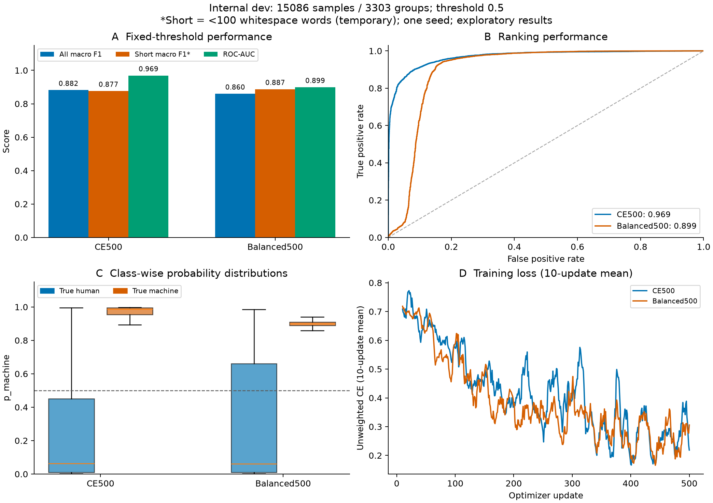
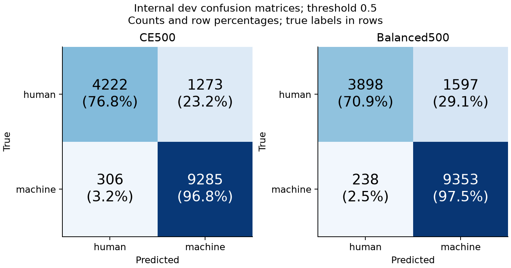
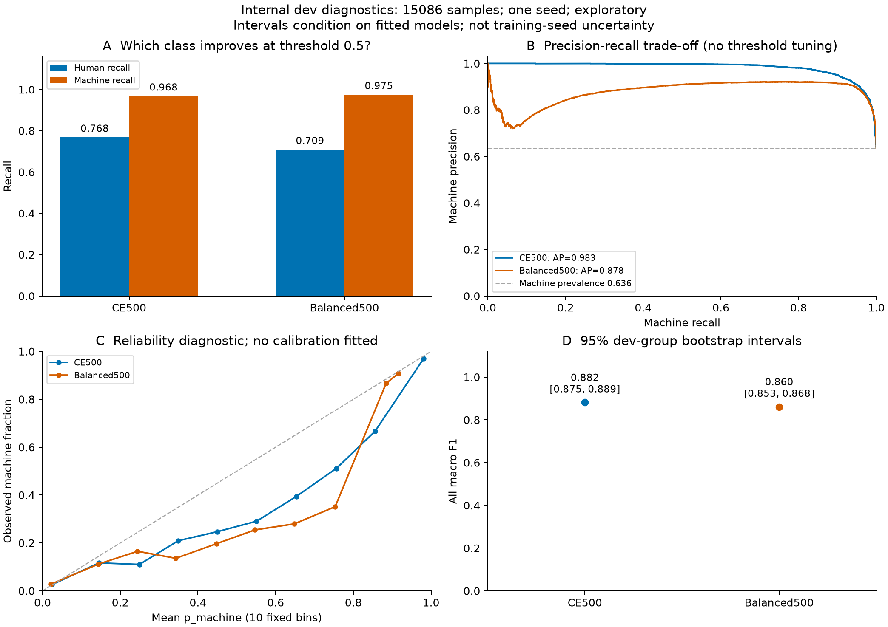

# internal-v2：完整dev上的500步先导对照

本轮候选按临时综合分比较为 **CE500**。这是一项单seed、约6.7%训练样本覆盖的固定预算先导实验，尚非完整epoch或最终比赛模型。A的PR #3已合并main `7231172`；数据独立验收见 `handoffs/B/full_data_acceptance_v2/`。本目录产物先交B分支，经PR进入main后A/C再拉取。

## 同版本对照

完整train119842条、dev15086条/3303组。两项均从原始 `FacebookAI/xlm-roberta-base` revision `e73636d4f797dec63c3081bb6ed5c7b0bb3f2089`独立初始化，seed42、max_length256、batch1、累积16、lr2e-5恒定、AdamW wd0.01、FP16、梯度检查点、num_workers0、确定性模式。dev不参与梯度更新，仅在预定500步终点评估，没有根据中途dev选checkpoint。

| 实验 | 全体宏F1 | 短文本宏F1* | 临时S* | AUC | human召回 | machine召回 |
| --- | ---: | ---: | ---: | ---: | ---: | ---: |
| CE500 | 0.8820 | 0.8766 | 0.8804 | 0.9693 | 0.7683 | 0.9681 |
| Balanced500 | 0.8601 | 0.8875 | 0.8683 | 0.8993 | 0.7094 | 0.9752 |

阈值固定0.5；*短文本按空白计词<100，仅临时口径（1841条），S=0.7×全体宏F1+0.3×短文本宏F1。A统一脚本显式使用 `--short-by word`。不填官方分数。旧v1与v2小样成绩使用不同dev，不能直接并表声称提升。

Balanced500−CE500的全体宏F1差值为-0.021980，配对dev组bootstrap95%区间[-0.028641, -0.014057]。区间仅针对当前两组固定模型与dev组抽样，不包含训练seed不确定性；单seed不能宣布稳定优胜。

## 这次结果说明什么

本轮选择CE500：加权短文本宏F1提高0.0109，但全体下降0.0220，临时综合分下降0.0121。加权让human误报从1273增加到1597（多324条），machine漏检从306减少到238（少68条），总错误增加256条。human召回76.8%→70.9%，machine召回96.8%→97.5%，整体取舍不利。

加权的AUC也从0.9693降到0.8993，AP从0.9828降到0.8782；因此本轮差异不只体现在0.5阈值，不能据此假设只改阈值就能恢复。这是当前数据、步数和seed下的结果，不推断类别加权普遍无效。

CE500当前主要薄弱点是human误报：PeerRead、arXiv的human召回分别约58.9%、64.0%，见slices.csv。后续优先延长无加权训练并增加第二seed，再独立验证长度方案；不沿用旧v1小样上加权获益的结论。

## 图表解读



A面板比较固定阈值宏F1及AUC；B看排序能力；C检查两类p_machine是否分开、是否挤在0.5附近；D为未加权CE的10次更新滑动均值，避免直接混比不同加权损失。训练loss下降不能单独证明dev或泛化提升。



行是真实标签、列为预测，顺序均human/machine。每格提供数量和行比例；human行的machine格是人类误判，machine行的human格是漏检机器文本。



A看两类召回的取舍；B是machine为正类的PR曲线，虚线为dev机器比例；C按固定10箱检查概率与真实机器占比是否一致，仅作诊断，未拟合校准器；D为按dev组重采样的宏F1区间。曲线用于解释模型，本轮未搜索阈值。

## 工程验收与运行

两项均完成GPU训练、有限损失/概率检查、15086条编号/行数/顺序核验，保存前与新进程加载后同为FP32/batch8，最大概率差分别为CE500=0、Balanced500=0。

- CE500：训练commit `eb68cc4e00f7e3ec830e18e46b14e2261c377f4a`；500次有效更新/503次尝试，FP16跳步3次，处理8048条（训练集6.72%）；训练609.84秒，峰值allocated/reserved 5772.20/5952 MiB。保存前dev推理144.84秒，独立加载及推理151.59秒。
- Balanced500：训练commit `aa3064cc96f0a4f968f4cc3fbd10118ff29f5488`；500次有效更新/503次尝试，FP16跳步3次，处理8048条（训练集6.72%）；训练605.35秒，峰值allocated/reserved 5772.20/5952 MiB。保存前dev推理144.52秒，独立加载及推理151.57秒。

逐次样本抽取哈希共同前缀一致、训练核心Git blob相同，详见draw_order_check.json。FP16跳步导致的实际样本暴露差异如实记录，不将两项说成样本数完全相同。训练速度是本机测量，CE阶段同时做了CPU只读长度统计，不据小幅耗时差异声称加权更快。

CE500打包入口另用A冻结的200条smoke_dev（完整dev精确子集）做新进程检查：FP32/batch8、顺序/编号/有限范围通过，与完整dev按编号对应的概率最大差0。两份本机checkpoint均带独立源码/依赖/标签配置/清单；CE500_package_inventory.json只交接指纹，不包含权重。见packaged_smoke_check.json。

## 下一步

1. 优先把CE500按完整状态恢复到2000步（新输出目录、其余配置保持一致），另从原始模型用seed43训练相同步数，判断步数与seed稳定性；当前约6.7%覆盖不足以替代完整训练。本阶段未启动2000步实验。
2. 单独验证256/512输入长度及显存。长度统计显示train/dev约73.6%/74.0%超过256token，23.5%/23.2%超过512；human的截断比例更高。长度统计只说明存在信息截断，不能证明512必定提高性能。
3. 给C同一完整v2 dev预测，用于其基线/融合与校准对照；等待A确认官方计词/阈值。生成器/域切片在slices.csv，单类别切片不报双类宏F1，不当作未见生成器归因结论。

内部test与官方验证集未用于本轮训练、推理、选参数或图表。没有新划分或改写A数据；完整数据/个人runs/恢复状态/权重留本地，仅共享本目录必要预测、配置、汇总和图。所有结果仍为内部开发结果。

## 可复制命令

运行命令见CE500_arguments.json、Balanced500_arguments.json及 `main_model/README.md`，输出目录须新建。复画：

```powershell
python main_model/analyze_performance.py --gold-internal-dev data/processed/v2/dev.jsonl --run CE500=runs/b_v2_full_ce500 --run Balanced500=runs/b_v2_full_balanced500 --output-dir runs/b_v2_full_pilot_analysis_repeat
```

独立预测（目录仍为本机运行产物）：

```powershell
python main_model/predict.py --model-dir runs/b_v2_full_ce500/checkpoint --input data/processed/v2/dev.jsonl --output runs/v2_candidate_dev_repeat.csv --precision fp32 --batch-size 8
```
