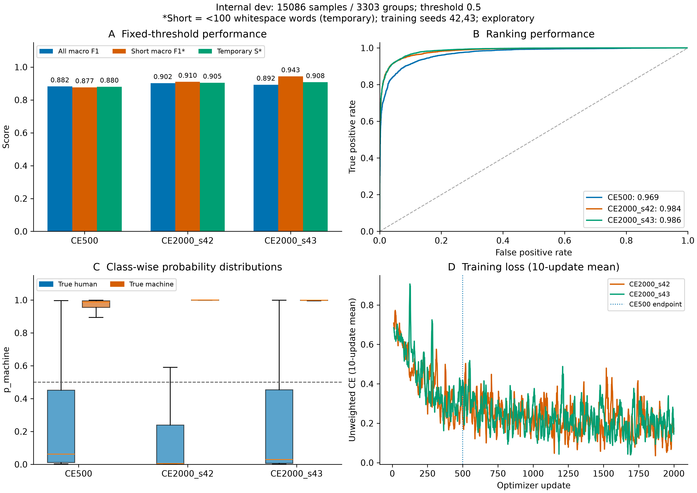
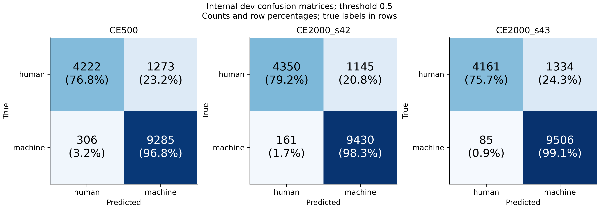
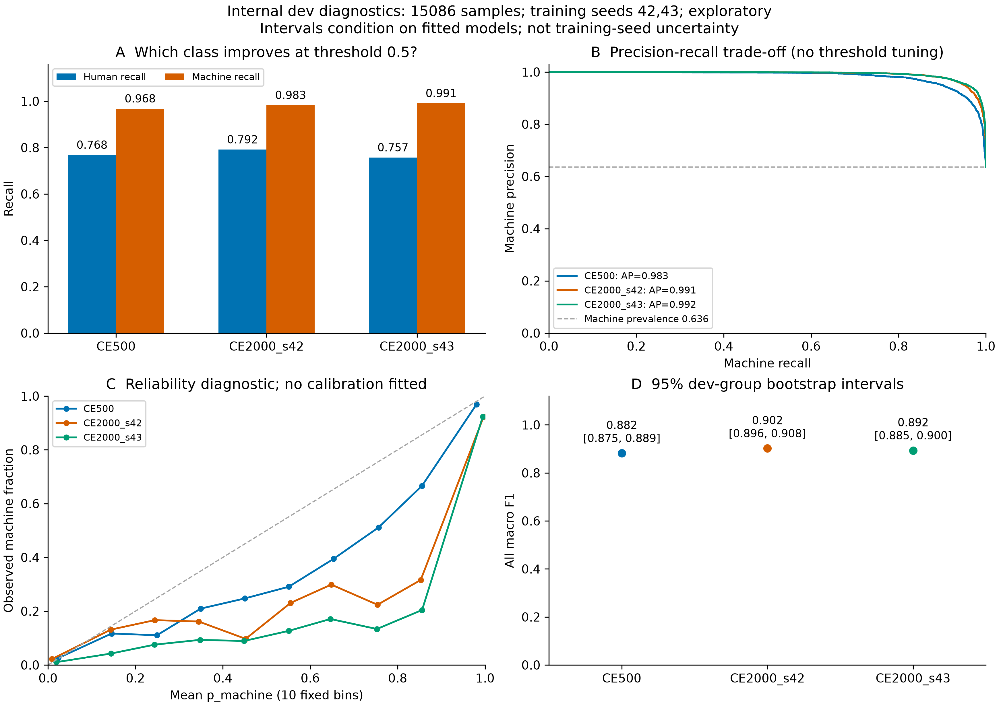

# v2：训练步数与第二seed对照（2000步）

本轮固定比较完成，按预先声明的临时S，当前候选为 **CE2000_s43**。先导实验只覆盖约27%的训练行，尚非完整epoch或最终比赛模型。本目录按固定节点交接计划、预测、评估图与验收记录；本机完整runs/权重不进入本目录。

## 对照与实际结果

A固定internal-v2，train119842、dev15086条/3303组。统一长度256、无加权、batch1/累积16、lr2e-5恒定、AdamW wd0.01、FP16、梯度检查点、num_workers0、确定性模式。seed42从CE500的完整状态恢复到总2000步；seed43从同一原始FacebookAI/xlm-roberta-base revision `e73636d4f797dec63c3081bb6ed5c7b0bb3f2089`开始2000步。只在预定终点评估，不按中途dev选checkpoint。

| 模型 | 全体宏F1 | 短文本宏F1* | 临时S* | AUC | human召回 | machine召回 |
| --- | ---: | ---: | ---: | ---: | ---: | ---: |
| CE500 | 0.8820 | 0.8766 | 0.8804 | 0.9693 | 0.7683 | 0.9681 |
| CE2000_s42 | 0.9024 | 0.9101 | 0.9047 | 0.9840 | 0.7916 | 0.9832 |
| CE2000_s43 | 0.8924 | 0.9433 | 0.9077 | 0.9859 | 0.7572 | 0.9911 |

*阈值0.5；短文本为空白计词<100（1841条）的临时口径，S=0.7×全体宏F1+0.3×短文本宏F1。A脚本显式使用word；不是官方分数。500步模型与两项2000步模型均使用完全相同的dev哈希和编号顺序。

## 怎样解读

- 同一seed42轨迹延长训练：全体宏F1变化+0.020310，配对dev组bootstrap95%区间[+0.013468, +0.027154]；总错误1579→1306。原CE500的503次历史日志为恢复轨迹精确前缀，训练核心代码Git blob一致，见trajectory_verification.json。
- 两个2000步seed：seed43−seed42全体宏F1变化-0.009921；两者临时S为0.904689/0.907691。seed同时影响初始化、抽样顺序和已见训练子集，两项暴露不是逐条匹配。按预定临时S选seed43（比seed42高0.003002），但seed42全体宏F1更高、human误报更少；两项均保留，待官方计词规则确认后重新按确定口径比较，不能把当前候选说成全面最优。
- 图中bootstrap区间只针对固定模型下的dev组抽样，不能解释成训练seed的置信区间。两个seed只提供初步复验信息，不代表已充分估计seed波动。
- 分类得分与概率质量分开看：CE500/2000_s42/2000_s43的log loss为0.2429/0.3204/0.3029，Brier为0.0749/0.0744/0.0770。seed42的分类得分提高但log loss变差，可靠性图保留这个取舍，不能只依据F1宣布所有方面改善。

## 图表



A展示全体宏F1/临时短文本宏F1/临时S；B展示排序能力和AUC；C为两类概率箱线图（中位数、四分位数及1.5 IQR须，隐藏离群点标记，非最小—最大范围；统计使用全部样本），极窄箱体可能呈现为线；D为未加权CE的10次更新滑动均值。CE500是seed42轨迹前缀，因此不重复画其曲线，以竖虚线标记500步位置。



行是真实标签，列为预测，顺序human/machine；右上是human误报，左下是machine漏检，不能仅看对角线数量而忽略类别比例。



PR以machine为正类，虚线为dev机器比例；可靠性按固定10箱统计，未拟合校准器或搜索阈值。domain/generator切片在slices.csv，单类别切片不报双类宏F1，不据此宣布未见生成器归因性能。

三组图提供300dpi PNG与可编辑PDF/SVG。最终版本均通过1.5pt多面板对齐、PDF实际字形≥5pt、文字碰撞检查及11个面板人工复核；已修正召回图图例遮挡。检查记录见figure_qa.json及各图alignment/collision/pdf_text.json。图表源数据在metrics/calibration/training_curves/slices.csv，原始正文不导出。

## 保存与独立加载验收

全部模型的完整dev预测均由独立进程生成并逐条检查编号、顺序、数量、machine方向与有限[0,1]范围；保存前后同为FP32/batch8，具体最大概率差见各运行摘要。CE2000_s42/43均须PASS才进入本目录。

候选CE2000_s43已完成独立打包入口检查：使用A冻结的200条v2 smoke_dev（完整dev精确子集），FP32/batch8，按编号对应完整dev概率，最大差0，容差rtol1e-5/atol1e-6。输入小样是A原交付，不重新划分。selected_package_inventory.json交接本机包的文件指纹，selected_package_check.json为实测结果。

## 时间、显存与训练覆盖

- CE500: 累计500次更新/503次尝试、8048条抽取；累计活动训练609.84秒，本次段墙钟620.61秒；训练峰值allocated/reserved 5772.20/5952 MiB。
- CE2000_s42: 累计2000次更新/2003次尝试、32048条抽取；累计活动训练2472.34秒，本次段墙钟1897.81秒；训练峰值allocated/reserved 5772.20/6072 MiB。
- CE2000_s43: 累计2000次更新/2003次尝试、32048条抽取；累计活动训练2430.33秒，本次段墙钟2474.41秒；训练峰值allocated/reserved 5772.20/5952 MiB。

seed42本次新增活动训练1862.49秒、新增24000条；累计数字含原500步，不能重复计算。活动时间/墙钟是本机测量，不能据单次耗时差异声称某seed更高效。完整dev单次FP32推理约数分钟，实际耗时在运行摘要。

2000步约32000条抽取，仅覆盖约26.7%训练行；训练集尚未遍历完。模型只读正文，不将generator/domain/sample_id等作为特征。内部test与官方验证集没有参与本轮训练、选参、推理或图表。

## 复现与后续

参数与来源见三个arguments/summary、plan.json和pretrained_source_manifest.json，恢复检查点为可信本机状态。下列输出目录须不存在；resume命令需要本机原有完整500步检查点（不随本次交接上传）。命令使用当前环境的python，默认FP16与梯度检查点；调参集不参与梯度更新。

```powershell
# seed42：从完整500步状态继续到总计2000步
python main_model/train.py --train-file data/processed/v2/train.jsonl --dev-file data/processed/v2/dev.jsonl --model-dir models/xlm-roberta-base --output-dir runs/reproduce_ce2000_s42 --data-kind a-internal --data-manifest data/processed/v2/manifest.json --evaluation-script data_tools/evaluate.py --seed 42 --max-steps 2000 --max-length 256 --batch-size 1 --gradient-accumulation 16 --learning-rate 2e-5 --class-weighting none --save-steps 250 --keep-checkpoints 2 --deterministic --inference-batch-size 8 --resume-from runs/b_v2_full_ce500/checkpoints/step-000500

# seed43：从固定原始预训练模型独立开始
python main_model/train.py --train-file data/processed/v2/train.jsonl --dev-file data/processed/v2/dev.jsonl --model-dir models/xlm-roberta-base --output-dir runs/reproduce_ce2000_s43 --data-kind a-internal --data-manifest data/processed/v2/manifest.json --evaluation-script data_tools/evaluate.py --seed 43 --max-steps 2000 --max-length 256 --batch-size 1 --gradient-accumulation 16 --learning-rate 2e-5 --class-weighting none --save-steps 250 --keep-checkpoints 2 --deterministic --inference-batch-size 8

# 当前候选的独立打包入口；权重保留本机，接收方需另行取得模型包
python runs/b_v2_ce2000_seed43/checkpoint/predict.py --model-dir runs/b_v2_ce2000_seed43/checkpoint --input data/processed/v2/smoke_dev.jsonl --output runs/reproduce_candidate_predictions.csv --precision fp32 --batch-size 8
```

复画：

```powershell
python main_model/analyze_performance.py --gold-internal-dev data/processed/v2/dev.jsonl --run CE500=runs/b_v2_full_ce500 --run CE2000_s42=runs/b_v2_ce2000_resume --run CE2000_s43=runs/b_v2_ce2000_seed43 --prefix-run CE500 --output-dir runs/b_v2_round2_analysis_repeat
```

后续按本轮结果选择固定配置，扩大训练覆盖，并单独比较256/512长度与显存；概率质量另作诊断/校准对照。官方计词、阈值仍待核实，最终模型与流程尚待冻结。提交阶段再核对实际交接需求，不以其他成员提交状态替代本模型的实测证据。

## 交接边界与待办

A的v2 train/dev、小样、manifest和统一评估脚本均已接收并实测；尚需确认官方多语言计词、概率阈值及最终输出模板。当前模型包在本机，包指纹及独立入口检查在本目录；权重尚未作为冻结的共享模型上传，A跨机器复现仍属后续H05。B本轮结果通过个人分支PR交接，是否进入main以PR实际合并状态为准。
